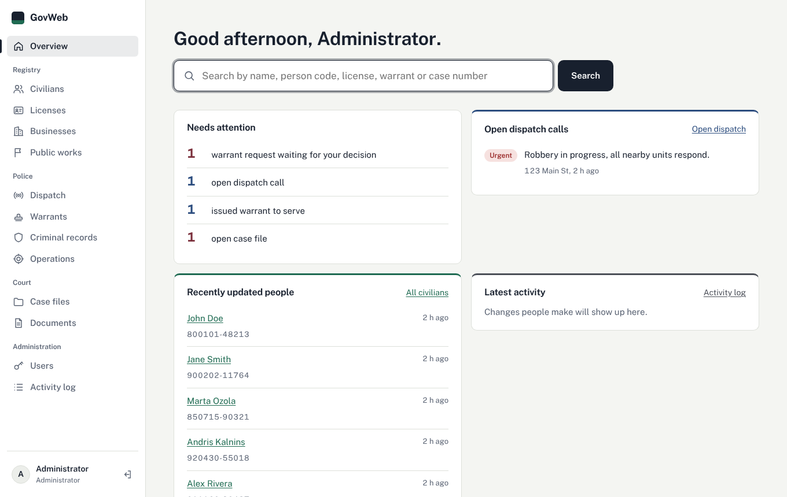
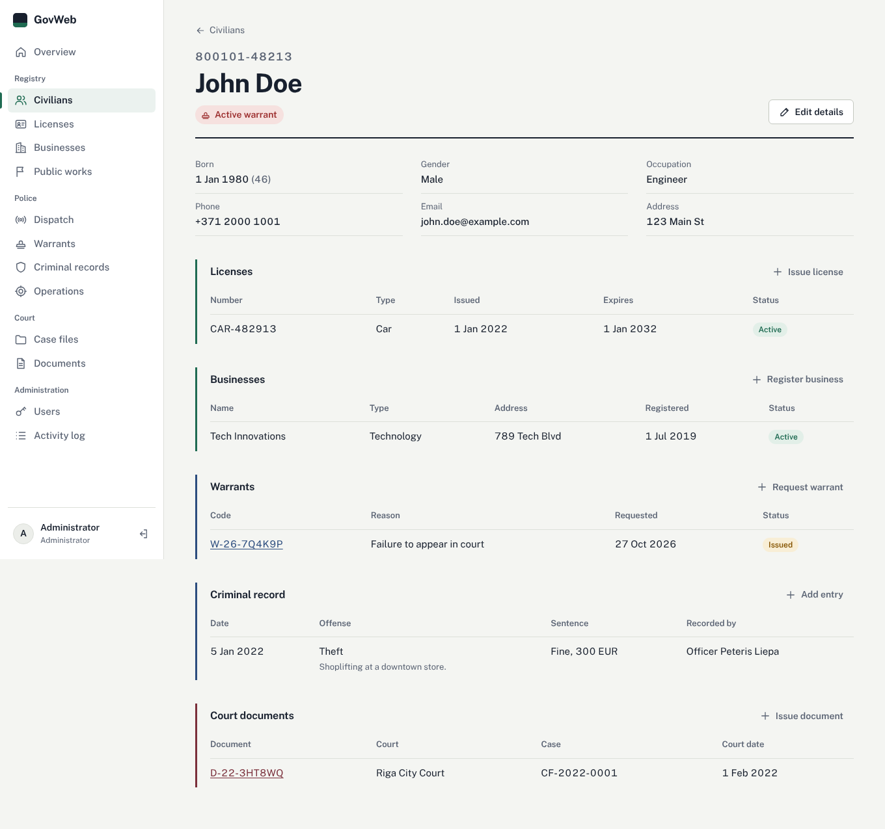
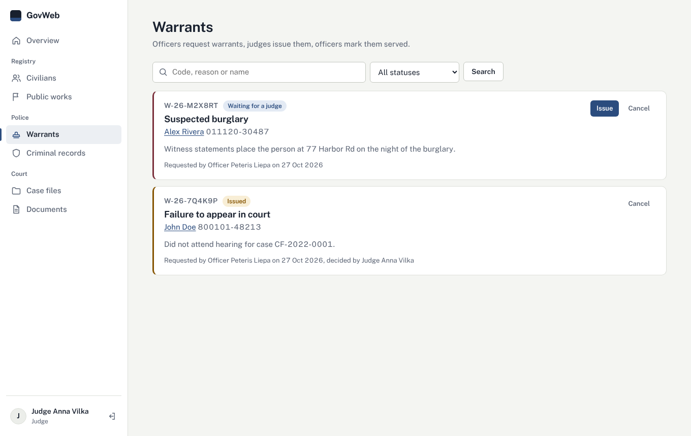

# GovWeb

A records system for a (fictional) government: the civil register, licenses and businesses, police dispatch and warrants, and the courts. Each role sees only what it needs.

Plain PHP 8 and MySQL, no framework and no build step, so it runs on a stock [WampServer](https://sourceforge.net/projects/wampserver/), XAMPP or any PHP host.



## What each role can do

| Role | Can do |
| --- | --- |
| Administrator | Everything, plus user accounts and the activity log |
| Registrar | Registers people, issues licenses, registers businesses, manages public works |
| Police officer | Dispatch calls, criminal records, police operations. Requests and serves warrants |
| Judge | Case files and court documents (printable). Issues or cancels warrants |
| Civilian | Sees their own record: licenses, businesses, court documents |

Warrants follow a real approval chain: an officer requests one, a judge issues or cancels it, an officer marks it served.



## Set up with WampServer

1. Copy this folder into WampServer's `www` folder, for example `C:\wamp64\www\GovWeb`.
2. Open phpMyAdmin (`http://localhost/phpmyadmin`), go to **Import** and import `database/schema.sql`, then `database/seed.sql`. The first creates the `government_registration` database, the second adds demo data.
3. Open `http://localhost/GovWeb`.

The default settings match a fresh WampServer install (user `root`, no password). If yours differ, copy `app/config.local.example.php` to `app/config.local.php` and edit it. Environment variables `DB_HOST`, `DB_PORT`, `DB_NAME`, `DB_USER`, `DB_PASSWORD` and `APP_DEBUG` work too.

### Or with PHP's built-in server

```sh
mysql -u root < database/schema.sql
mysql -u root < database/seed.sql
APP_DEBUG=1 php -S localhost:8000
```

Then open `http://localhost:8000`.

### Demo accounts

All use the password `password`: `admin`, `registrar`, `officer`, `judge`, and `john` (a civilian). Before using GovWeb for anything real, delete these accounts, create your own under **Users**, and set `show_demo_accounts` to `false` in `app/config.php`.

## Security

- Every query uses prepared statements (PDO). User input never goes into SQL text.
- Every form carries a CSRF token, and all output is HTML-escaped.
- Passwords are hashed with `password_hash`. Accounts lock for 10 minutes after 5 wrong passwords.
- Permissions are checked on the server for every page and every action, not just hidden in the menu. They're defined in one place: `PERMISSIONS` in `app/auth.php`.
- Sessions use HttpOnly, SameSite cookies, a new session ID on sign-in, and sign out after 2 hours idle.
- Every change is written to the activity log with who made it and from which IP address.
- `app/` and `database/` have `.htaccess` files so Apache won't serve them. On other servers, point the web root away from them or block them.

## Project layout

```
app/            bootstrap, database helpers, auth, validation, layout (not web-accessible)
  views/        page layout, error page, the person record
assets/         CSS, JavaScript, favicon
database/       schema.sql and seed.sql
registry/       civilians, licenses, businesses
police/         dispatch, warrants, criminal records
court/          case files and court documents
admin/          users and activity log
index.php       overview with search and a "needs attention" list
search.php      search across every register you have access to
operations.php  police operations and public works (one page, two agencies)
```

Every page starts with `require .../app/bootstrap.php`, then calls `require_can('some.permission')`. To add a page, copy a similar one.



## License

GPL-3.0. See [LICENSE](LICENSE).
